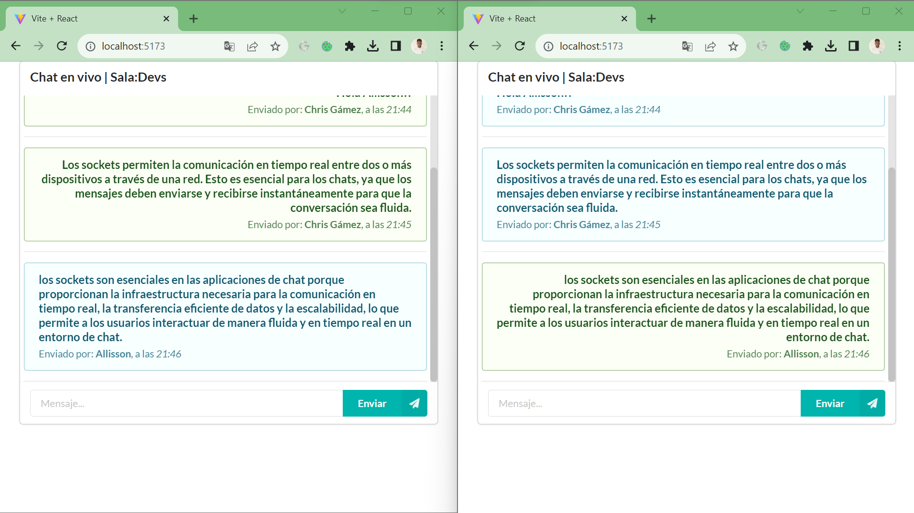

# Chat en tiempo real — Backend

Servidor de mensajería creado con **Node.js, Express y Socket.IO**, con integración de **MongoDB a través de Mongoose**.



## Tecnologías
- Node.js y Express
- Socket.IO
- MongoDB y Mongoose
- dotenv y CORS

## Descripción
Este repositorio contiene el backend de un chat web en tiempo real. Se complementa con una interfaz construida en React.

## Ejecutar localmente
Requisitos: Node.js, npm y la configuración de servicios externos que utilice tu instalación.

```bash
npm install
npm run dev
```

Configurar las variables de entorno necesarias de manera local; **no subir credenciales ni archivos `.env` a GitHub**.

## Frontend
Repositorio complementario: [mensajerofront](https://github.com/nahuel170/mensajerofront).

## Autor
[Nahuel Raspo](https://github.com/nahuel170)
